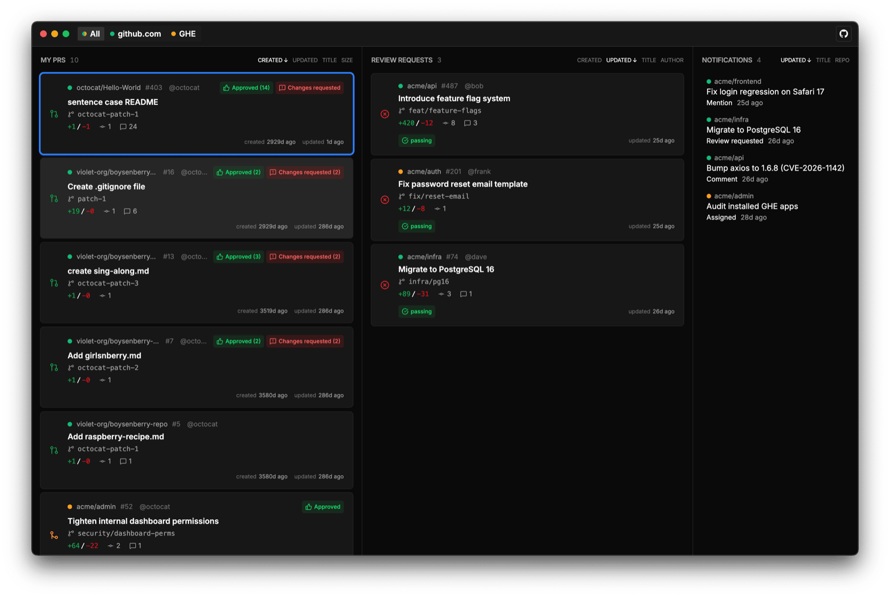

# GitHub Dashboard

A keyboard-driven dashboard for your GitHub pull requests, review requests and notifications, across multiple GitHub instances (github.com + GitHub Enterprise).



## Clients

There are currently two clients:

- **TUI** (`packages/cli`) — terminal UI built on the new sync engine (`packages/sync`, SQLite cache + bulk GraphQL). Browse PRs/reviews/notifications, read descriptions and comments, review diffs and post line comments, toggle draft/auto-merge, approve. Press `?` for keyboard shortcuts.
- **Web app** (`packages/web` + `packages/server`, optionally wrapped in Electron via `packages/desktop`) — browser dashboard backed by a Hono API adapter to the shared sync engine and SQLite cache. A pre-built macOS app is on the [Releases page](https://github.com/AntonNiklasson/github-dashboard/releases).

## Development

Requires Node 22+ and pnpm. TUI icons need a Nerd Font.

```sh
pnpm install

pnpm dev:cli           # TUI, restarts on source changes
pnpm dev:web           # web app: server (:7100) + Vite (:7200)
pnpm dev               # web app in an Electron window
```

Other useful commands:

```sh
pnpm cli tui --demo    # TUI with sample data; no config or network (after `pnpm build`)
pnpm typecheck
pnpm test
pnpm lint
pnpm fmt:check
```

The CLI also has non-interactive commands for scripting (after `pnpm build`): `pnpm --silent cli once --json`, `pnpm --silent cli list --json` (offline, reads the cache) and `pnpm cli watch`. They accept `--instance` and `--kind` (`prs`, `reviews`, `notifications`).

## Configuration

Both clients read `~/.config/github-dashboard/config.yml` (honors `$XDG_CONFIG_HOME`):

```yaml
theme: system # web app only: system | light | dark
instances: # one or more
  - domain: github.com
    token: ghp_...
  - domain: ghe.example.com
    label: GHE
    token: ghp_...
```

- **domain** — `github.com` or a GHES host. A bare host, URL or full API base all work.
- **token** — personal access token with `repo` and `notifications` scopes ([create one for github.com](https://github.com/settings/tokens/new?scopes=repo,notifications&description=GitHub%20Dashboard)).
- **label** — optional display name. Defaults to the domain.

TUI state lives in XDG dirs and is safe to delete:

- `~/.cache/github-dashboard/cache.sqlite` — sync cache
- `~/.local/state/github-dashboard/tui.json` — last view, instance and sorting

### Desktop/web sync engine scope

The desktop and web clients use `packages/sync` for all GitHub access, including authentication, list synchronization, comments and file diffs. Supported writes are approval, draft/ready toggling, auto-merge toggling and notification dismissal. Direct merge/close, title editing, CI reruns, posting conversation comments, closed-PR search, colleague browsing, and detailed commit/check lists are currently unavailable; use “Open in browser” for those operations. The local Hono HTTP API remains the renderer transport, but owns no GitHub client or live cache.

### Repeatable feedback loop

Run `pnpm scenario` to develop against a controllable local GitHub simulator, or `pnpm test:e2e` to check queue transitions in Chromium through the real sync engine and SQLite cache. Both use disposable configuration and fake credentials. See [the harness guide](packages/harness/README.md) for setup, controls, and failure artifacts.
